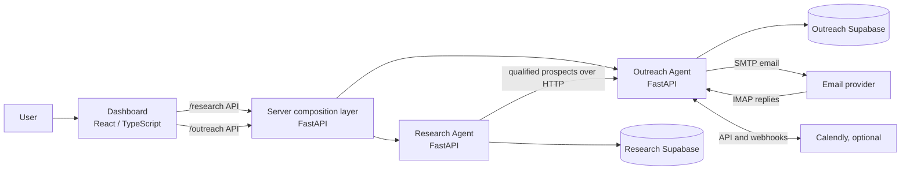

# CSG Prospecting and Outreach System

## 1. Purpose

This repository contains an integrated system for discovering and qualifying potential staffing clients, preparing and managing outreach campaigns, handling prospect replies, and reviewing campaign performance. It consists of two independently owned backend agents and one shared browser dashboard. A small composition service runs both backends behind a single API origin in the standard deployment.

The system is designed to keep research and outreach data separate while connecting them through HTTP APIs. The research-to-outreach hand-off can create prospects and email drafts, but sending remains a human-controlled action. Reply automation is separately opt-in for each campaign.

## 2. At A Glance

| Component | Responsibility | Technology | Data ownership |
|---|---|---|---|
| Research Agent | Discover companies, gather firmographics and job signals, score and qualify companies, find verified contacts, and optionally hand off qualified prospects | Python, FastAPI, Typer CLI | Its own Supabase/PostgreSQL project |
| Outreach Agent | Import prospects, create campaigns, draft and send email, manage post-send conversations, scheduling data, learning, optimization, and analytics | Python, FastAPI, Typer CLI | Its own separate Supabase/PostgreSQL project |
| Server | Mount both FastAPI applications under one origin; provide dashboard authentication, CORS, and optional scheduled automation | Python, FastAPI, Uvicorn | No business database of its own |
| Dashboard | Provide the unified user interface for research, campaigns, conversations, bookings, analytics, and insights | React, TypeScript, Vite | No database; calls backend APIs directly |

Typical local addresses are `http://127.0.0.1:8000/research`, `http://127.0.0.1:8000/outreach`, and `http://127.0.0.1:5173` for the Dashboard.



## 3. Component Responsibilities

### Research Agent

The Research Agent takes a geographic region as its main run input. The Ideal Customer Profile (ICP) in `Research_Agent/config/icp.yaml` defines the target company characteristics, search regions, scoring weights, tiers, disqualifiers, and qualification/contact limits.

Its workflow discovers candidate companies, gathers company details, detects applicant tracking systems (ATS) and open roles where possible, scores companies against the ICP, optionally generates an LLM qualification summary and recommended outreach angle, and finds recruiting contacts with verified email addresses. It provides a FastAPI API and a Typer command-line interface; its user interface is part of the shared Dashboard.

Company identity and duplicate handling are based primarily on normalized domains, with normalized names as a fallback. Previously qualified or suppressed companies are treated differently from companies that were merely discovered or whose qualification attempt failed; eligible companies may be reconsidered in later runs. A failed qualification is recorded separately from a successful qualification so it can be inspected and retried.

The Research Agent uses provider integrations for company discovery/research, qualification, and contact finding. Gemini is the primary discovery provider, with configurable key rotation and a Tavily/Groq fallback. Anthropic can be used as an alternative qualification provider. Hunter.io is used for contact discovery. Exact behavior and configuration are documented in `Research_Agent/README.md` and `Research_Agent/WORKFLOW.md`.

### Outreach Agent

The Outreach Agent maintains a local snapshot of imported prospects in its own database. It does not read or write the Research Agent's database. Prospect information is obtained from Research over HTTP, and `research_domain` is used as a cross-system identifier.

The core workflow selects prospects for a campaign, generates personalized email drafts, presents them for review, and sends approved email through a configured SMTP account. Drafting can use qualification information from Research, other cached research fields, optional web-search-assisted redrafting, and a static template as a fallback. Campaign items are tracked through stages such as `needs_review`, `pending`, `sent`, `waiting`, `replied`, `booked`, and `not_interested`/failed.

Outreach also contains several related but independently scoped capabilities:

- **Conversation Agent:** Processes post-send replies using IMAP, classifies messages, records conversation history, and advances campaign stages. It is disabled by default per campaign. Enabling it allows reply processing and draft creation; sending those replies automatically requires the separate `auto_reply` setting.
- **Follow-ups and automation:** Follow-ups are subject to configured schedules and limits. The Server's background polling loop is opt-in using `AUTO_SYNC_ENABLED`; without it, inbox and follow-up processing can be initiated manually.
- **Calendly integration:** Optional API synchronization and signed webhooks attach booking and cancellation events to prospects. The integration can enrich booking views and reconcile calendar cancellations with campaign stages.
- **Feedback Learning:** Records AI-generated and human-edited drafts, observes outcomes, and surfaces confidence-gated patterns to guide later drafts. It reports associations, not causal effects.
- **Campaign Optimization:** Compares campaign strategies and observed outcomes, supports explicit recommendation adoption tracking, and reports comparisons with a non-causality caveat.
- **Analytics:** Provides campaign, sender, and prospect-level performance and drill-down data.

These capabilities are additive to the send pipeline: learning and optimization observe outcomes and can inform future drafts, but are not required for ordinary campaign creation or sending.

### Server Composition Layer

`Server/app.py` mounts the Research API at `/research` and the Outreach API at `/outreach` in one FastAPI process. It is an integration and hosting layer, not a third business agent. It coordinates both applications' lifespans and adds cross-cutting concerns:

- Shared dashboard password authentication, with an HMAC-based session token.
- CORS configuration for the Dashboard.
- An optional background automation loop for inbox, Calendly, and follow-up work.
- A root Calendly webhook alias for compatibility.

The two agents continue to use separately scoped Supabase URL and service-key variables. The Server startup checks that both agents' database credentials are present. Either agent can also run as a standalone FastAPI app, but standalone mode does not include the Server's dashboard authentication or scheduled automation.

### Dashboard

The Dashboard is a browser-only single-page application. It has typed API clients under `Dashboard/src/agents/` and pages for Research and Outreach workflows under `Dashboard/src/pages/`. It does not connect to Supabase directly and is not a proxy or backend aggregator. It uses the Server's login endpoint and keeps the resulting access token in browser `sessionStorage`.

Dashboard functionality includes research runs and company details, saved companies and contacts, prospect imports, campaign creation and a kanban pipeline, reply review, Calendly bookings, analytics, and Learning/Optimization insights. A shared in-memory stale-while-revalidate data layer is implemented in `Dashboard/src/hooks/useCachedFetch.ts`.

## 4. End-to-End Business Flow

1. **Configure an ICP and start a research run.** A run is initiated through the Dashboard/API or the CLI. The API/Dashboard workflow can automatically qualify and find contacts for a capped number of Tier A/B companies; CLI usage keeps those potentially quota-consuming steps explicit unless requested.
2. **Discover and assess companies.** Research collects company details and hiring signals, checks for duplicates and suppression, and calculates a rules-based score and tier. An unavailable careers/ATS source is distinguished from a verified source that has no open roles.
3. **Qualify and find contacts.** When enabled by the selected workflow, an LLM generates a pain summary and recommended angle; Hunter.io looks for verified email contacts. Qualification attempts and failures are recorded.
4. **Optionally hand off to Outreach.** When `OUTREACH_API_BASE` is configured and the relevant qualification/contact stages ran, Research calls Outreach over HTTP. Contactable prospects are imported and can be placed into a campaign with personalized drafts. A hand-off failure is recorded without invalidating the completed research run.
5. **Review and send.** A person reviews the campaign in the Dashboard and sends emails. The hand-off does not send emails automatically.
6. **Handle replies and bookings.** A person can update stages manually. When enabled for a campaign, the Conversation Agent checks the inbox, matches and classifies messages, records threads, and drafts replies/follow-ups. `auto_reply` is an additional control for sending those messages without approval. Calendly synchronization/webhooks can update booking records and stages.
7. **Review performance and improve future drafts.** Analytics summarizes outcomes. Learning and Optimization derive evidence-gated observations from drafts and campaign outcomes and can supply guidance for future drafting.

## 5. Data Ownership And Boundaries

The system has two separate Supabase projects:

- Research owns runs, companies, discovery sources, job postings, scores, qualifications and qualification attempts, contacts, saved companies, suppression records, duplicate matches, and API usage records.
- Outreach owns imported prospect snapshots, campaigns, outreach items/events, conversation settings/messages, follow-up and automation state, Calendly records/tombstones, draft versions, learning insights/events, optimization insights/adoptions.

There is no shared table and no direct database connection between agents. Research-to-Outreach transfer uses the APIs. Outreach stores a copy of imported prospect details and the Research domain key, so it can continue to manage campaigns without joining Research tables.

Within Outreach, the Conversation Agent intentionally uses the Outreach database and campaign items. The core Outreach workflow owns pre-send stages; conversation processing owns post-send behavior. User stage changes remain available through the Dashboard.

## 6. Integrations

| Integration | Used for | Configuration location |
|---|---|---|
| Supabase/PostgreSQL via PostgREST | Persistent storage, one project per backend agent | `RESEARCH_SUPABASE_*`, `OUTREACH_SUPABASE_*` |
| Gemini | Research discovery and LLM tasks; also used for outreach drafting where configured | `GEMINI_API_KEY` and optional numbered keys |
| Tavily and Groq | Research discovery fallback and optional web-search-assisted outreach redrafting | `TAVILY_API_KEY`, `GROQ_API_KEY` |
| Anthropic | Optional qualification and outreach drafting/redrafting provider | `ANTHROPIC_API_KEY` |
| Hunter.io | Contact discovery | `HUNTER_API_KEY` |
| SMTP | Outbound campaign email and any enabled automatic replies | SMTP and sender settings |
| IMAP | Inbox/reply retrieval for the Conversation Agent | IMAP settings |
| Calendly | Optional event types, booking sync, cancellation handling, scheduling links, and webhooks | Calendly API token, webhook signing key, and scheduling URL settings |

Provider availability and fallback order can vary by operation. Each agent README is the source of truth for specific provider behavior and environment variable details. Secrets belong in local environment files or deployment secret settings, not in the Dashboard bundle or source control.

## 7. Security And Operational Controls

- The Server's `DASHBOARD_PASSWORD` protects Dashboard API access. If unset in the standard Server deployment, protected routes fail closed with HTTP 503.
- Calendly webhooks are exempted from Dashboard login because they are server-to-server; webhook authenticity is checked with the configured signing key.
- Research and Outreach use separate service credentials. Avoid legacy unscoped `SUPABASE_URL` / `SUPABASE_SERVICE_KEY` variables.
- The Dashboard keeps its token in `sessionStorage`; the password is submitted to the backend and is not embedded in the frontend bundle.
- Research-to-Outreach hand-off creates/imports prospects and drafts but does not send email.
- Conversation processing is off by default per campaign. Automatic reply sending requires `auto_reply` in addition to enabling the Conversation Agent.
- Background polling is disabled by default. Enable it deliberately and configure its interval and provider credentials.
- SMTP, IMAP, LLM, contact-provider, and database credentials must be managed as deployment secrets and rotated according to the hosting team's policy.

This is a shared-password model, not a multi-user identity/role system. Standalone agent processes do not include the Server's dashboard authentication; they should not be exposed publicly without an appropriate access-control layer.

## 8. Deployment And Development

The recommended deployment is the repository Docker image running `Server/app.py` as one backend service, with the Dashboard deployed separately as a static SPA. The repository also includes a Vercel multi-service option and supports standalone agents for isolated operation. The Vercel/standalone shapes do not provide the Server's shared-password middleware or long-running background scheduler; see `DEPLOYMENT.md` for tradeoffs and exact setup.

For local development, install the three Python packages into one environment, start the Server composition app on port 8000, and start the Dashboard with Vite (typically port 5173). Set up both independent Supabase projects and their schemas before exercising database-backed workflows. See `QUICKSTART.md`, `run.txt`, and the component READMEs for exact commands and environment setup.

## 9. Repository Code Map

| Path | Contents |
|---|---|
| `Research_Agent/src/csg/api.py` | Research HTTP API and job progress endpoints |
| `Research_Agent/src/csg/cli.py` | Research CLI commands |
| `Research_Agent/src/csg/discover.py` | Research run orchestration |
| `Research_Agent/src/csg/discovery/` and `ats/` | Discovery providers, firmographic research, ATS integrations |
| `Research_Agent/src/csg/scoring.py`, `qualify.py`, `contacts.py`, `dedupe.py` | Scoring, LLM qualification, contact discovery, duplicate handling |
| `Research_Agent/config/icp.yaml` | ICP, search, scoring, tiers, and run limits |
| `Research_Agent/schema.sql`, `migrations/` | Research database schema and upgrades |
| `Outreach_Agent/src/outreach/api.py` | Outreach HTTP API and router registration |
| `Outreach_Agent/src/outreach/ingest.py`, `personalize.py`, `pipeline.py` | Import/campaign setup, drafting, sending workflow |
| `Outreach_Agent/src/outreach/conversation/` | Reply matching, classification, drafting, and follow-ups |
| `Outreach_Agent/src/outreach/automation/`, `calendly/`, `analytics/`, `learning/`, `optimization/` | Scheduled work and supporting Outreach capabilities |
| `Outreach_Agent/config/outreach.yaml` | Outreach limits, providers, senders, and personalization settings |
| `Outreach_Agent/schema.sql`, `migrations/` | Outreach database schema and upgrades |
| `Server/app.py` | Combined app mounting, authentication, CORS, and optional scheduler lifecycle |
| `Dashboard/src/agents/` | Typed browser clients for backend APIs |
| `Dashboard/src/pages/` | Research and Outreach user-facing workflows |
| `Dashboard/src/components/`, `hooks/` | Shared UI and client-side data fetching/cache |
| `Dockerfile`, `vercel.json`, `Dashboard/vercel.json` | Deployment definitions |

## 10. Testing And Quality Checks

The Research and Outreach Python test suites are designed to run offline using mocked provider boundaries and fake database/PostgREST behavior. The Server suite checks combined mounting and cross-cutting behavior such as authentication, CORS, lifespans, and database-variable isolation. The Dashboard has a TypeScript build/typecheck as its primary automated guard rail. CI configuration is in `.github/workflows/ci.yml`.

Typical checks:

```powershell
cd Research_Agent
pytest

cd ..\Outreach_Agent
pytest

cd ..\Server
pytest

cd ..\Dashboard
npx tsc -b --noEmit
```

The Server tests require the Research, Outreach, and Server packages to be installed in the same active Python environment. Test counts may change as the project evolves; use the current test runner output rather than treating a count in documentation as a release metric.

## 11. Current Boundaries And Limitations

- Research and Outreach are separate deployable packages and databases, but their operational workflow depends on reachable APIs for imports and hand-offs.
- Dashboard authentication is a single shared password/token model; there are no individual accounts or role-based permissions.
- Scheduled automation exists only when running under the Server composition process and is opt-in.
- The Dashboard is the unified UI; the backend agents expose APIs and CLIs rather than separate maintained frontend applications.
- Learning and campaign optimization analyze observed data. They should be treated as decision support rather than controlled experiments or causal proof.
- External-provider limits, credentials, and outages can affect discovery, enrichment, qualification, drafting, email, inbox polling, or scheduling features independently.

## 12. Further Reading

- [Repository README](README.md) — concise product and workflow overview.
- [CLAUDE.md](CLAUDE.md) — project structure, conventions, common development tasks, and architecture notes.
- [QUICKSTART.md](QUICKSTART.md) and [run.txt](run.txt) — local setup and launch commands.
- [DEPLOYMENT.md](DEPLOYMENT.md) — deployment choices, environment configuration, and database setup.
- [Research Agent README](Research_Agent/README.md) and [workflow](Research_Agent/WORKFLOW.md) — research behavior and operations.
- [Outreach Agent README](Outreach_Agent/README.md) and [workflow](Outreach_Agent/WORKFLOW.md) — outreach, conversation, calendar, and campaign behavior.
- [Dashboard README](Dashboard/README.md) — Dashboard architecture and frontend extension points.
- [Server README](Server/README.md) — combined API process, authentication, scheduler, and standalone operation.